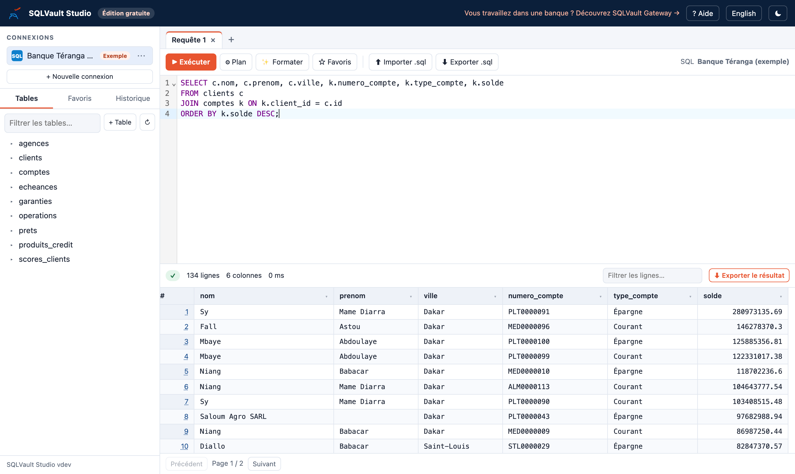

# SQLVault Studio

**Le client SQL gratuit, complet et sans limite, pour apprendre et développer.**
*The free, complete and unlimited SQL client for learning and development.*



**[Télécharger](https://github.com/sqlvaultgateway/sqlvault-studio/releases/latest)** · **[Guide utilisateur](docs/GUIDE.md)** · Windows · macOS · Linux · Docker

## Pourquoi SQLVault Studio ?

- **Un seul outil pour toutes les bases** : MySQL, MariaDB, PostgreSQL, SQL Server, Oracle et SQLite, avec le même écran.
- **Rien d'autre à installer** : un serveur MySQL ou PostgreSQL s'installe en un clic, comme avec XAMPP, et s'arrête quand vous fermez l'application.
- **Simple pour débuter, complet pour travailler** : afficher une table, la modifier, la créer avec un formulaire, importer ou exporter une base, sans écrire une ligne de SQL si vous le souhaitez.
- **On apprend en cliquant** : chaque action affiche la requête SQL envoyée (`CREATE TABLE`, `UPDATE`, `DELETE`, `DROP`…).
- **Une base d'exemple réaliste** pour s'exercer tout de suite : la Banque Téranga, une banque fictive avec ses clients, comptes, opérations et crédits.
- **Gratuit et sans limite** : ni compte, ni publicité, ni nombre maximal de connexions, de favoris ou d'exports.
- **Vos données restent chez vous** : l'application tourne sur votre ordinateur et n'envoie rien.
- **Léger et bilingue** : moins de 30 Mo, en français ou en anglais, thème clair ou sombre.

| | SQLVault Studio | XAMPP + phpMyAdmin |
| --- | --- | --- |
| Bases prises en charge | MySQL, MariaDB, PostgreSQL, SQL Server, Oracle, SQLite | MySQL, MariaDB |
| Serveur local en un clic | MySQL et PostgreSQL | MySQL |
| Application installée sur le poste | oui, avec sa propre fenêtre | serveur web local + navigateur |
| Base d'exemple prête à l'emploi | oui | non |
| Requête SQL affichée après chaque modification | oui | oui |

## Fonctionnalités

- **Éditeur** : autocomplétion des tables et colonnes, plusieurs onglets, mise en forme, plan d'exécution, favoris, historique.
- **Résultats** : toutes les colonnes, tri et filtre par colonne comme dans Excel, détail d'une ligne, jusqu'à 100 000 lignes affichées.
- **Export du résultat complet** : Excel, CSV, JSON ou instructions INSERT.
- **Tables** : afficher, structure, créer avec un formulaire (clés primaires et étrangères), insérer, modifier par double-clic, supprimer, vider.
- **Bases** : créer, supprimer, importer et exporter des fichiers `.sql` comme les sauvegardes de phpMyAdmin (jusqu'à 1 Go).

## Installer

### Avec l'assistant

| Système | Fichier (page [Releases](https://github.com/sqlvaultgateway/sqlvault-studio/releases/latest)) | Installation |
| --- | --- | --- |
| Windows 10 / 11 | `SQLVault-Studio-<version>-Windows-x64.exe` | Suivant, Suivant, Installer · sans droits administrateur |
| macOS 13+ (puce Apple ou Intel) | `SQLVault-Studio-<version>-macOS.dmg` | glisser l'application dans Applications |
| Linux | `sqlvault-studio-<version>-linux-amd64.zip` (ou `arm64`) | décompresser, lancer `sqlvault-studio` |

L'application n'est pas encore signée. Au premier lancement :
- **Windows** : « Informations complémentaires » puis « Exécuter quand même » ;
- **macOS** : Réglages Système › Confidentialité et sécurité › « Ouvrir quand même ».

### En ligne de commande

```bash
# macOS et Linux
curl -fsSL https://raw.githubusercontent.com/sqlvaultgateway/sqlvault-studio/main/install.sh | sh
```

```powershell
# Windows (PowerShell)
irm https://raw.githubusercontent.com/sqlvaultgateway/sqlvault-studio/main/install.ps1 | iex
```

Les scripts installent la dernière version, sans question, après avoir vérifié son empreinte SHA-256 (fichier `SHA256SUMS.txt` de chaque version).

### Docker

```bash
docker run -d -p 127.0.0.1:4320:4320 -v sqlvault-studio:/data --name sqlvault-studio mbodji/sqlvault-studio
docker logs sqlvault-studio      # affiche l'adresse à ouvrir
```

Depuis le conteneur, une base installée sur votre poste se joint avec l'hôte `host.docker.internal`.

## Labo : quatre vrais serveurs avec Docker

Pour s'exercer sur MySQL, PostgreSQL, SQL Server et Oracle, déjà remplis avec la Banque Téranga :

```bash
cd lab
docker compose up -d                      # Studio + MySQL + PostgreSQL
docker compose --profile sqlserver up -d  # + SQL Server
docker compose --profile oracle up -d     # + Oracle (environ 2 Go de mémoire)
docker compose logs studio                # adresse à ouvrir
```

## Aide

- **[Guide utilisateur](docs/GUIDE.md)** (aussi en PDF dans chaque version) : installation, écran, connexions, requêtes, tables, import et export, questions fréquentes.
- Un problème ou une idée : **sqlvaultgateway@gmail.com**

## Édition gratuite et SQLVault Gateway

SQLVault Studio est l'édition gratuite. Pour les banques et les entreprises qui doivent **contrôler et prouver** chaque accès aux données (masquage, double validation des modifications, journal d'audit infalsifiable, rapports planifiés), voir **[SQLVault Gateway](https://sqlvaultgateway.github.io)**.

---
© 2026 DEF TECH 2.0 · Licence gratuite : voir `LICENSE.txt` · Contact : sqlvaultgateway@gmail.com
