# Guide utilisateur de SQLVault Studio

SQLVault Studio est un client SQL gratuit, complet et sans limite, pour apprendre et développer. Il fonctionne sur votre ordinateur : vos bases et vos requêtes ne sont envoyées nulle part.

**Sommaire**

1. [Installer SQLVault Studio](#1-installer-sqlvault-studio)
2. [Découvrir l'écran](#2-découvrir-lécran)
3. [Se connecter à une base](#3-se-connecter-à-une-base)
4. [Écrire et exécuter des requêtes](#4-écrire-et-exécuter-des-requêtes)
5. [Lire, trier et filtrer un résultat](#5-lire-trier-et-filtrer-un-résultat)
6. [Exporter un résultat](#6-exporter-un-résultat)
7. [Travailler sur les tables](#7-travailler-sur-les-tables)
8. [Gérer les bases de données](#8-gérer-les-bases-de-données)
9. [Importer et exporter des fichiers .sql](#9-importer-et-exporter-des-fichiers-sql)
10. [Supprimer une connexion](#10-supprimer-une-connexion)
11. [Raccourcis clavier](#11-raccourcis-clavier)
12. [Vos données, mise à jour et désinstallation](#12-vos-données-mise-à-jour-et-désinstallation)
13. [Questions fréquentes](#13-questions-fréquentes)

---

## 1. Installer SQLVault Studio

Téléchargez le fichier de votre système dans la page **[Releases](https://github.com/sqlvaultgateway/sqlvault-studio/releases/latest)**.

### Windows 10 et 11 : avec l'assistant

1. Double-cliquez sur `SQLVault-Studio-<version>-Windows-x64.exe`.
2. Si Windows affiche « Windows a protégé votre ordinateur », cliquez sur **Informations complémentaires**, puis **Exécuter quand même** : l'application n'est pas encore signée.
3. Suivez l'assistant : **Suivant**, acceptez la licence, **Suivant**, **Installer**. Aucun droit administrateur n'est demandé.
4. Lancez SQLVault Studio depuis le menu Démarrer ou le raccourci du Bureau.

### macOS 13 et plus (puce Apple ou Intel)

1. Ouvrez `SQLVault-Studio-<version>-macOS.dmg`.
2. Glissez **SQLVault Studio** sur le dossier **Applications**.
3. Ouvrez-le depuis le Launchpad. La première fois, macOS peut le bloquer car il n'est pas encore signé par Apple : ouvrez **Réglages Système › Confidentialité et sécurité**, puis cliquez sur **Ouvrir quand même**.

### En ligne de commande

| Système | Commande |
| --- | --- |
| macOS, Linux | `curl -fsSL https://raw.githubusercontent.com/sqlvaultgateway/sqlvault-studio/main/install.sh \| sh` |
| Windows (PowerShell) | `irm https://raw.githubusercontent.com/sqlvaultgateway/sqlvault-studio/main/install.ps1 \| iex` |
| Docker | `docker run -d -p 127.0.0.1:4320:4320 -v sqlvault-studio:/data --name sqlvault-studio mbodji/sqlvault-studio` |

Les scripts téléchargent la dernière version, vérifient son empreinte SHA-256 et l'installent sans question. Sous Linux, lancez ensuite `sqlvault-studio` : l'interface s'ouvre dans le navigateur. Avec Docker, `docker logs sqlvault-studio` affiche l'adresse à ouvrir.

---

## 2. Découvrir l'écran

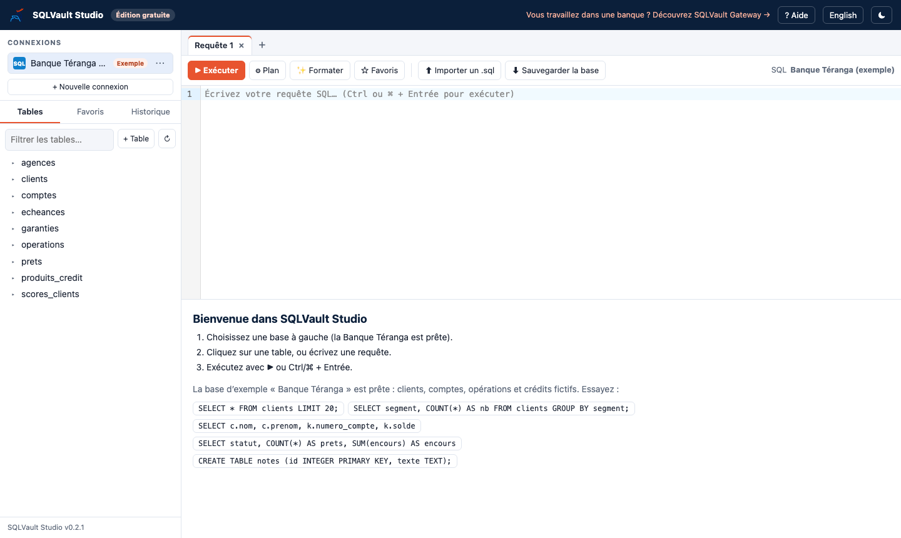

- **À gauche** : vos connexions, le choix de la base de données et la liste des tables. Les onglets **Favoris** et **Historique** retrouvent vos requêtes.
- **En haut à droite** : l'éditeur SQL, avec ses onglets (comme dans un navigateur) et la barre d'outils.
- **En bas à droite** : le résultat de la requête.
- **Barre du haut** : **Aide**, passage en anglais (**English**) et thème sombre (☾).

Au premier lancement, la base d'exemple **Banque Téranga** est prête : clients, comptes, opérations et crédits fictifs d'une banque sénégalaise. Les boutons de l'écran d'accueil exécutent des requêtes d'exemple.

---

## 3. Se connecter à une base

Cliquez sur **+ Nouvelle connexion**.

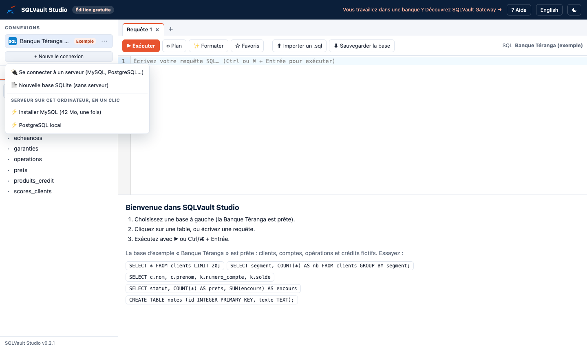

### Un serveur existant

**Se connecter à un serveur** : choisissez le type (MySQL, MariaDB, PostgreSQL, SQL Server, Oracle), puis l'hôte, le port, l'utilisateur et le mot de passe. **Tester la connexion** vérifie les paramètres avant d'enregistrer. Les mots de passe sont chiffrés sur votre ordinateur.

### Une base SQLite

**Nouvelle base SQLite** crée un fichier de base, sans aucun serveur. C'est la façon la plus simple de commencer.

### Un serveur MySQL ou PostgreSQL en un clic

Pas de serveur ? Choisissez **Installer MySQL** ou **Installer PostgreSQL**. SQLVault Studio le télécharge une seule fois (30 à 40 Mo), le démarre quand vous l'utilisez et l'arrête quand vous fermez l'application. Vos bases sont conservées d'une fois sur l'autre.

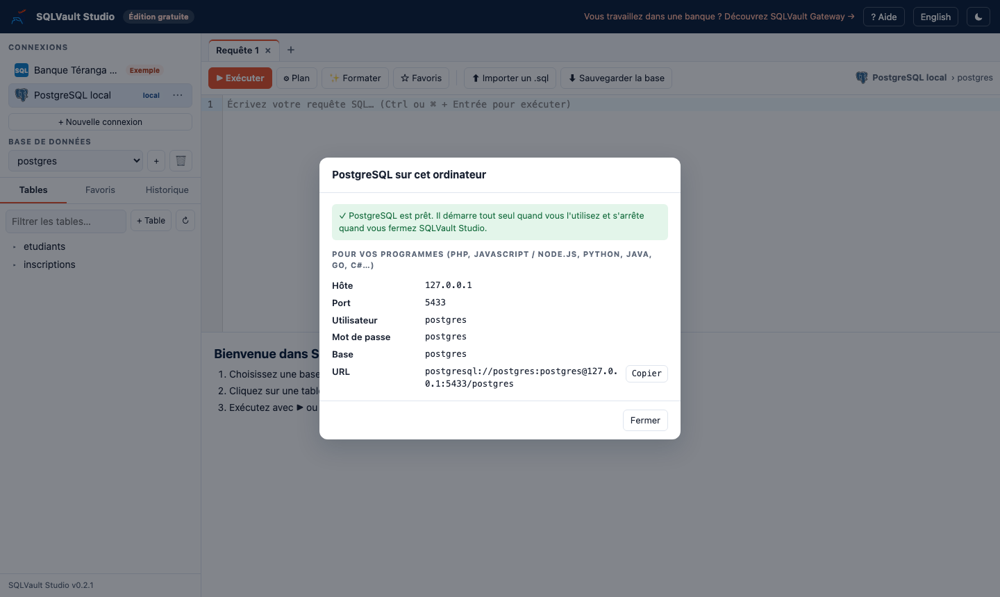

La fenêtre affiche les paramètres pour brancher vos propres programmes (PHP, JavaScript / Node.js, Python, Java, Go, C#…), ainsi qu'une adresse prête à copier.

| | MySQL local | PostgreSQL local |
| --- | --- | --- |
| Hôte | 127.0.0.1 | 127.0.0.1 |
| Port | 3307 (ou suivant) | 5433 (ou suivant) |
| Utilisateur | root | postgres |
| Mot de passe | (vide) | postgres |

Le MySQL local utilise le moteur Dolt, compatible MySQL. Le PostgreSQL local est un vrai PostgreSQL 17.

---

## 4. Écrire et exécuter des requêtes

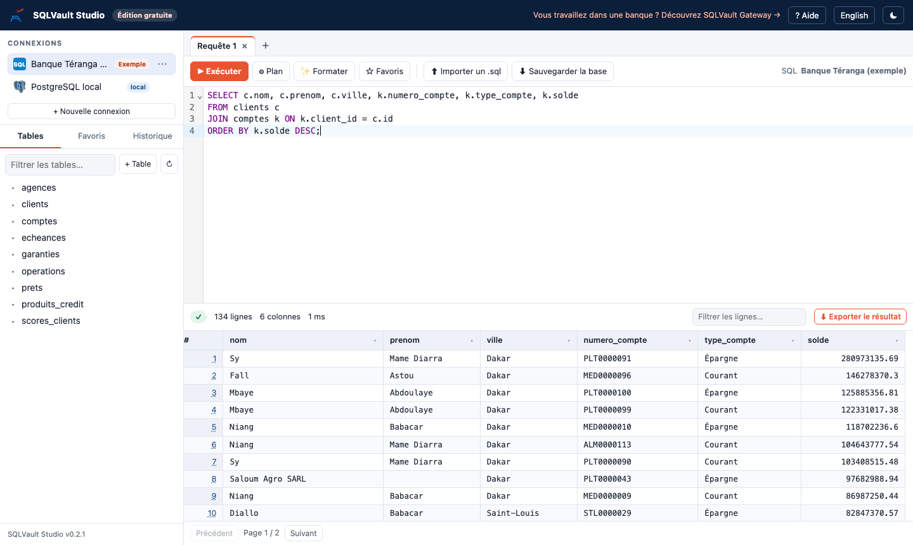

- Écrivez votre requête dans l'éditeur, puis cliquez sur **▶ Exécuter** ou appuyez sur **Ctrl + Entrée** (⌘ + Entrée sur Mac).
- S'il y a plusieurs instructions, seule celle où se trouve le curseur est exécutée. Pour en exécuter plusieurs, sélectionnez-les.
- **Ctrl + Espace** propose les tables et les colonnes de la base.
- **Formater** met la requête en forme ; **Plan** montre comment la base va l'exécuter.
- **☆ Favoris** enregistre la requête ; l'onglet **Historique** garde les 1 000 dernières.
- **+** à côté des onglets ouvre une nouvelle requête ; double-cliquez sur un onglet pour le renommer.
- **■ Arrêter** interrompt une requête trop longue.

---

## 5. Lire, trier et filtrer un résultat

- Le résultat affiche toutes les colonnes. Faites défiler horizontalement pour les voir.
- Les lignes sont présentées par pages de 100 (**Précédent** / **Suivant**), jusqu'à 100 000 lignes. L'export, lui, contient toujours toutes les lignes.
- Le champ **Filtrer les lignes** cherche un texte dans toutes les colonnes.

### Trier et filtrer une colonne

Cliquez sur le titre d'une colonne :

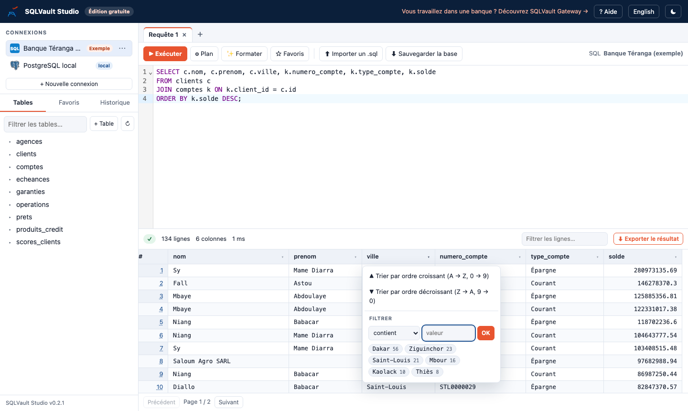

- **Trier** par ordre croissant ou décroissant.
- **Filtrer** : choisissez une condition (contient, est égal à, est différent de, commence par, supérieur à, inférieur à, est vide, n'est pas vide), tapez une valeur, puis **OK**.
- Ou cliquez sur l'une des **valeurs les plus fréquentes** pour filtrer directement dessus.

Vous pouvez filtrer plusieurs colonnes à la fois. La barre au-dessus du tableau indique le nombre de lignes affichées ; **Effacer** retire tous les filtres.

### Voir une ligne en entier

Cliquez sur le **numéro** d'une ligne : toutes ses valeurs s'affichent, avec un bouton **Copier** pour chacune. C'est pratique pour les tables très larges.

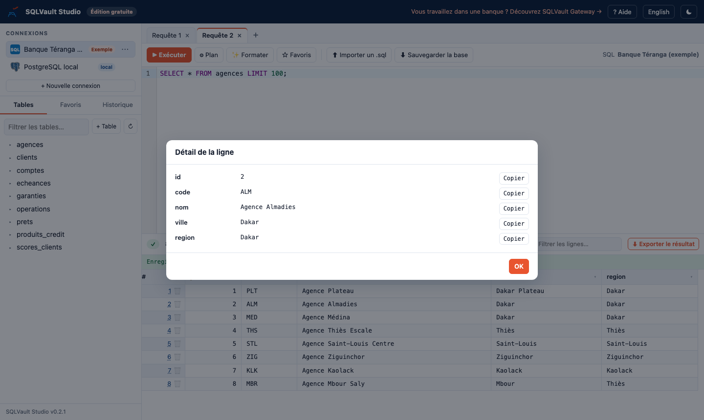

---

## 6. Exporter un résultat

Cliquez sur **⬇ Exporter le résultat**, au-dessus du tableau :

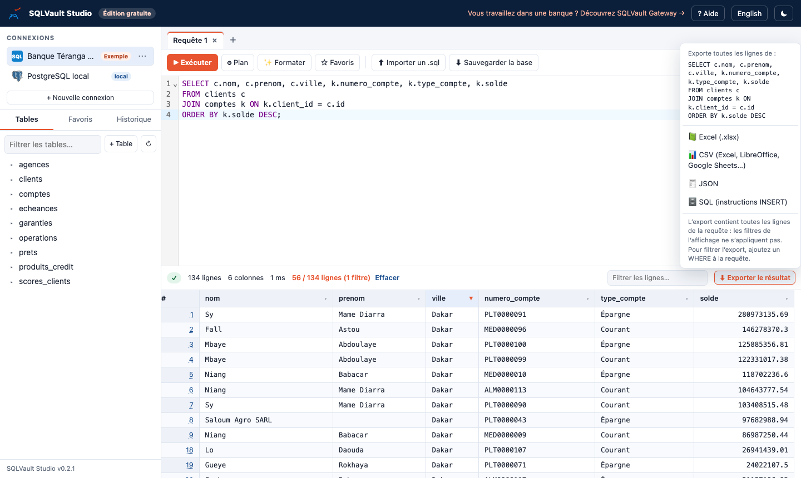

| Format | Pour quoi faire |
| --- | --- |
| **Excel (.xlsx)** | Ouvrir dans Excel : en-tête en gras et figé, nombres utilisables dans les formules |
| **CSV** | Excel, LibreOffice, Google Sheets, ou tout autre logiciel |
| **JSON** | Programmes et applications web |
| **SQL (INSERT)** | Recharger les lignes dans une autre base |

Le menu rappelle la requête exportée. L'export la relance et contient **toutes** ses lignes, `WHERE` compris : exécutez donc la requête (Ctrl + Entrée) avant d'exporter. Si vous l'avez modifiée sans la relancer, un avertissement s'affiche.

Les filtres de colonnes de l'affichage ne s'appliquent pas à l'export : pour filtrer l'export, ajoutez un `WHERE` à la requête.

À ne pas confondre avec **⬇ Sauvegarder la base** (barre d'outils), qui enregistre des tables entières : voir le chapitre 9.

---

## 7. Travailler sur les tables

Cliquez sur le nom d'une table pour afficher ses données. Le bouton **⋯** à droite d'une table ouvre ses actions :

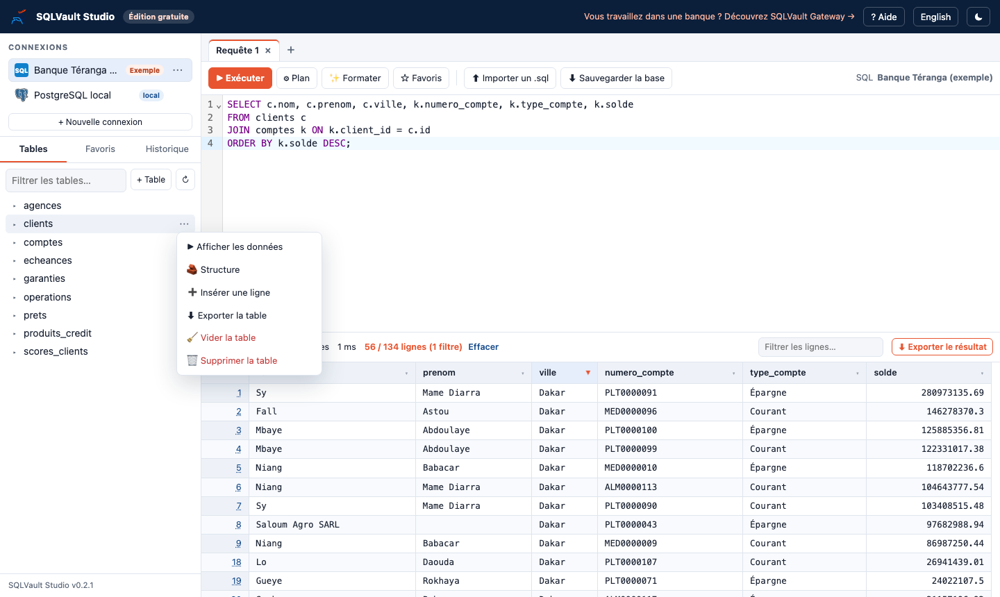

- **Afficher les données**, **Structure** (colonnes, types, clé primaire, valeurs par défaut) ;
- **Insérer une ligne**, **Exporter** la table ;
- **Vider** la table (toutes les lignes) ou la **Supprimer**. La requête est montrée et une confirmation est demandée.

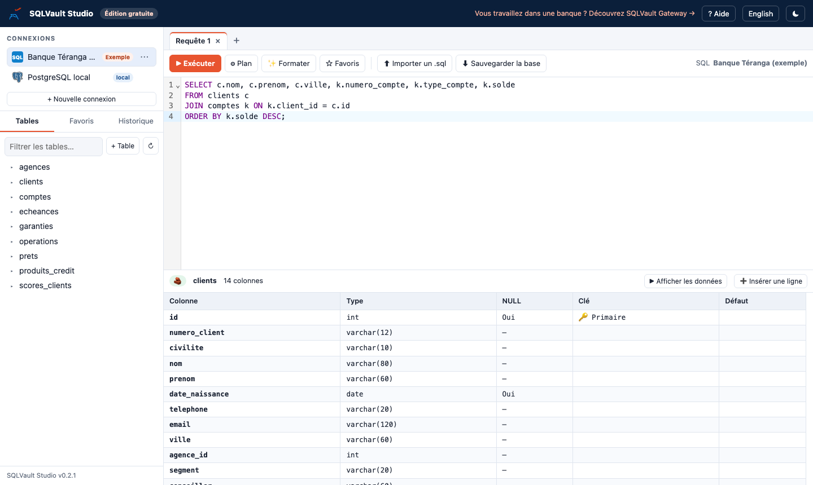

### Créer une table sans écrire de SQL

Cliquez sur **+ Table** au-dessus de la liste des tables.

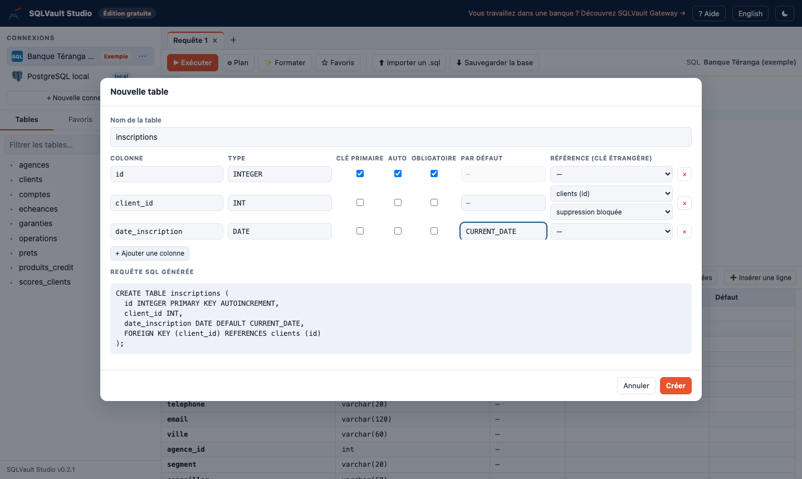

Pour chaque colonne, indiquez son nom et son type (des suggestions adaptées à votre base s'affichent), puis cochez si besoin :

- **Clé primaire** et **Auto** (numéro attribué automatiquement) ;
- **Obligatoire** (la valeur ne peut pas être vide) ;
- une valeur **Par défaut** (par exemple `CURRENT_DATE`) ;
- une **Référence** vers la clé primaire d'une autre table (clé étrangère), avec le comportement si la ligne référencée est supprimée : suppression bloquée, supprimer aussi (CASCADE) ou mettre à NULL.

La **requête SQL générée** s'écrit en direct sous le formulaire : c'est la meilleure façon d'apprendre `CREATE TABLE`.

### Modifier les données

Quand une table a une clé primaire, ses données sont modifiables :

- **double-cliquez sur une cellule**, changez la valeur, puis **Entrée** (Échap pour annuler) ;
- 🗑 au début d'une ligne la supprime ;
- **Insérer une ligne** ouvre un formulaire (valeur par défaut ou NULL, colonne par colonne).

La requête envoyée s'affiche à chaque fois, en vert au-dessus du tableau :

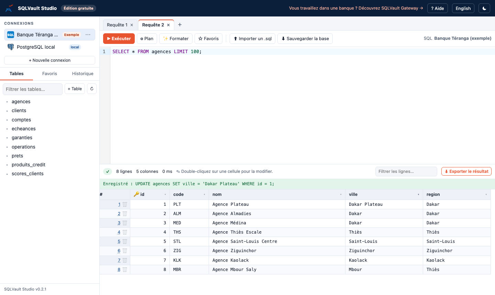

---

## 8. Gérer les bases de données

Pour MySQL, MariaDB, PostgreSQL et SQL Server, le menu **Base de données** à gauche choisit la base de travail.

- **+** crée une nouvelle base.
- 🗑 supprime la base choisie : il faut retaper son nom pour confirmer, car toutes ses tables et données sont effacées.

---

## 9. Importer et exporter des fichiers .sql

Ces fonctions s'utilisent comme les sauvegardes de phpMyAdmin.

### Exporter (sauvegarder)

**⬇ Sauvegarder la base** dans la barre d'outils : choisissez les tables, le contenu (structure et données, structure seule ou données seules) et l'ajout éventuel de `DROP TABLE`.

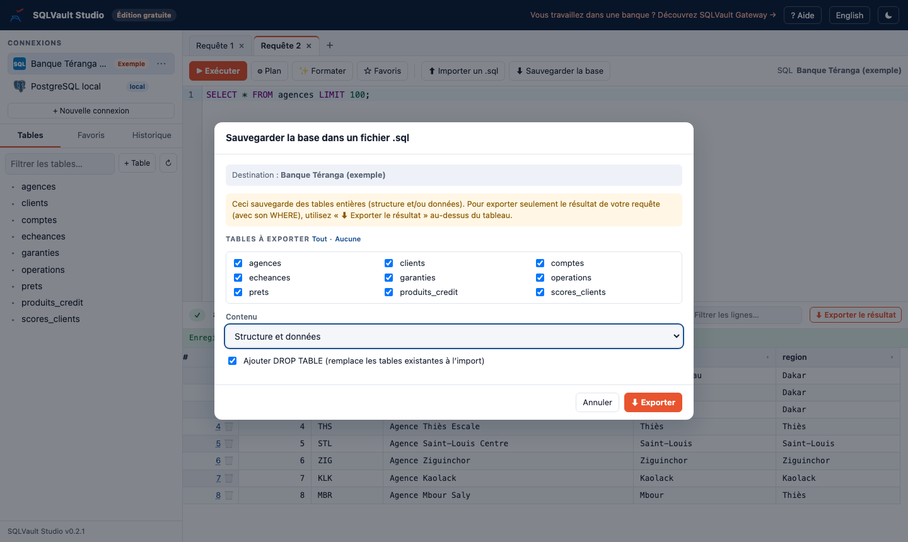

### Importer (restaurer ou exécuter un script)

**⬆ Importer un .sql** : choisissez le fichier ou glissez-le dans la fenêtre, puis **Importer**. Le script est exécuté sur la base choisie. En cas d'erreur, la ligne concernée est indiquée. Cochez **Arrêter à la première erreur** pour stopper dès le premier problème.

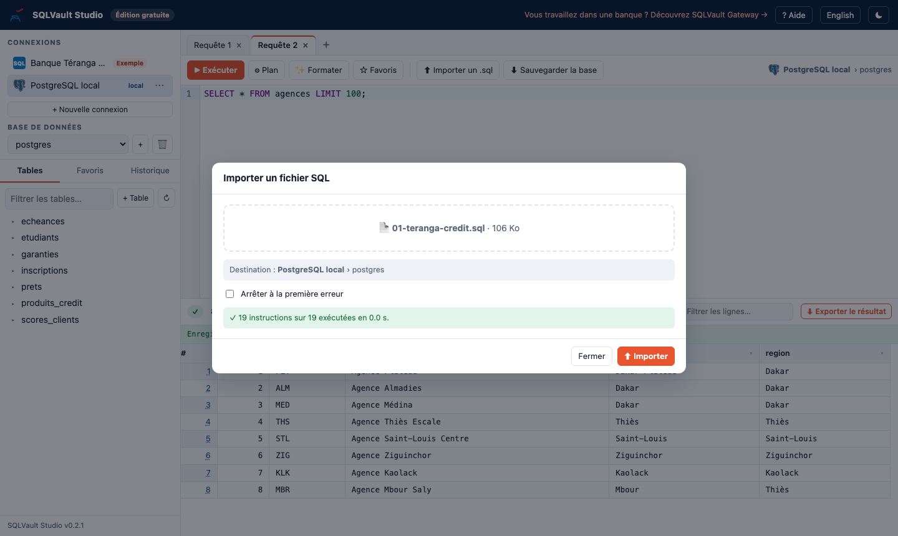

Les scripts de MySQL (avec `DELIMITER`), SQL Server (avec `GO`), Oracle (blocs PL/SQL et `/`), PostgreSQL (fonctions `$$`) et SQLite sont reconnus. Les fichiers jusqu'à 1 Go sont acceptés.

---

## 10. Supprimer une connexion

Cliquez sur **⋯** à droite d'une connexion, puis **Supprimer**. Vous choisissez ce que deviennent les données :

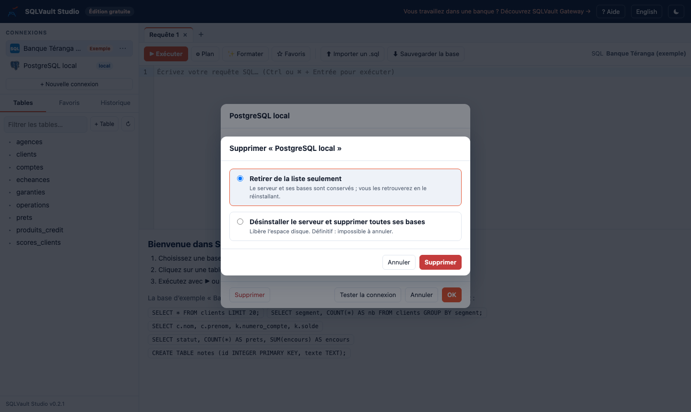

| Connexion | Choix proposés |
| --- | --- |
| Base SQLite | retirer de la liste seulement (le fichier est gardé), ou supprimer aussi le fichier |
| Serveur local (MySQL, PostgreSQL) | retirer seulement (vous retrouvez tout en le réinstallant), ou désinstaller le serveur et supprimer toutes ses bases |
| Serveur distant | la connexion est retirée ; les données sur le serveur ne sont jamais touchées |
| Base d'exemple | supprimée ; elle se réinstalle depuis **Aide › Réinstaller la base d'exemple** |

---

## 11. Raccourcis clavier

| Raccourci | Action |
| --- | --- |
| Ctrl / ⌘ + Entrée | Exécuter l'instruction sous le curseur (ou la sélection) |
| Ctrl / ⌘ + Maj + F | Mettre en forme la requête |
| Ctrl + Espace (aussi sur Mac) | Compléter les tables et colonnes |
| Ctrl / ⌘ + / | Commenter ou décommenter |
| Double-clic sur une cellule | Modifier la valeur |
| Échap | Fermer une fenêtre, annuler une modification |

Le bouton **Aide** rappelle ces raccourcis.

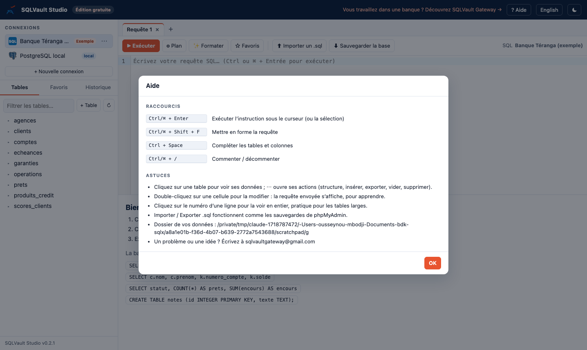

---

## 12. Vos données, mise à jour et désinstallation

**Vos données** (connexions, mots de passe chiffrés, favoris, historique, bases SQLite, serveurs locaux) sont dans :

| Système | Dossier |
| --- | --- |
| Windows | `%AppData%\SQLVault Studio` |
| macOS | `~/Library/Application Support/SQLVault Studio` |
| Linux | `~/.config/SQLVault Studio` |
| Docker | le volume `sqlvault-studio` |

**Mettre à jour** : installez la nouvelle version par-dessus l'ancienne (ou relancez la commande d'installation). Vos données sont conservées.

**Désinstaller** :

- Windows : Paramètres › Applications › SQLVault Studio › Désinstaller ;
- macOS : glissez l'application de **Applications** vers la Corbeille ;
- Linux : `curl -fsSL https://raw.githubusercontent.com/sqlvaultgateway/sqlvault-studio/main/install.sh | sh -s -- --uninstall`.

La désinstallation garde vos données. Pour tout effacer, supprimez aussi le dossier indiqué ci-dessus.

---

## 13. Questions fréquentes

**Faut-il une connexion Internet ?**
Non, sauf pour télécharger l'application et, la première fois, un serveur MySQL ou PostgreSQL local.

**Mes données sont-elles envoyées quelque part ?**
Non. SQLVault Studio ne collecte rien et n'envoie rien : il n'a ni compte, ni publicité, ni statistiques d'usage.

**Y a-t-il des limites ?**
Non : nombre de connexions, de favoris, de requêtes et d'exports illimité. Seul l'affichage s'arrête à 100 000 lignes pour rester fluide ; l'export contient tout.

**La connexion à mon serveur échoue.**
Le message indique la cause probable : hôte introuvable, port fermé, mot de passe refusé, base inexistante. Vérifiez que le serveur est démarré et utilisez **Tester la connexion**. Depuis Docker, un serveur installé sur votre poste se joint avec l'hôte `host.docker.internal`.

**Le serveur local ne démarre pas.**
Fermez puis rouvrez SQLVault Studio. Si le problème persiste, le journal du serveur se trouve dans le dossier de vos données, sous `serveurs/<mysql ou postgresql>/serveur.log`.

**Un problème, une idée ?**
Écrivez à **sqlvaultgateway@gmail.com**.

---

SQLVault Studio est l'édition gratuite de **[SQLVault Gateway](https://sqlvaultgateway.github.io)**, la plateforme qui contrôle et trace l'accès aux bases de données des banques.
